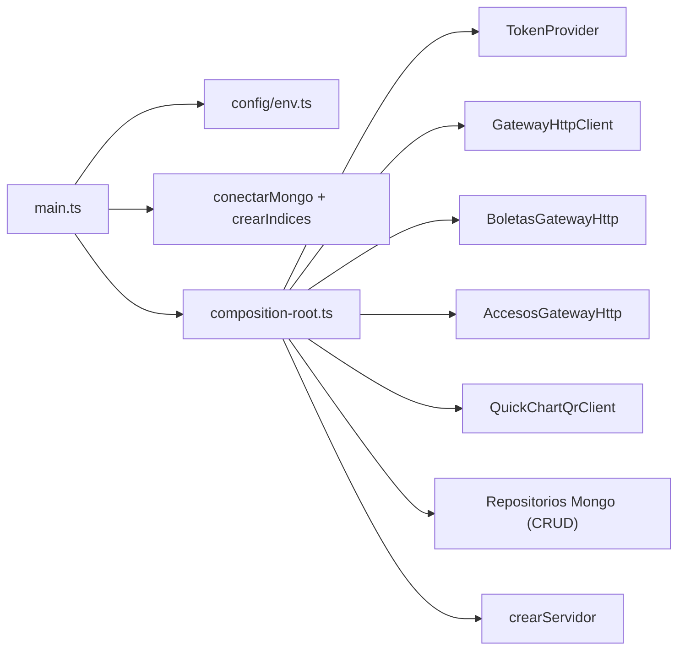
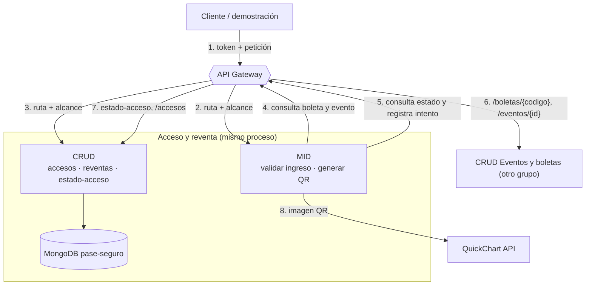
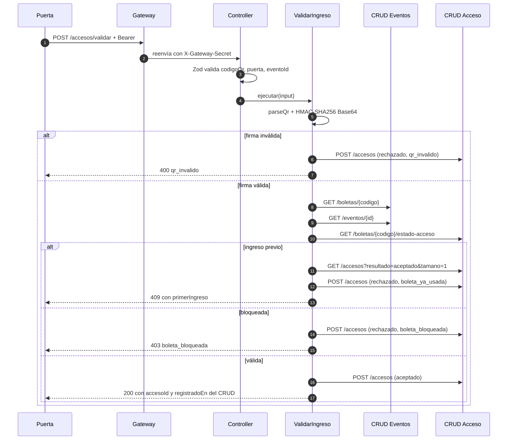
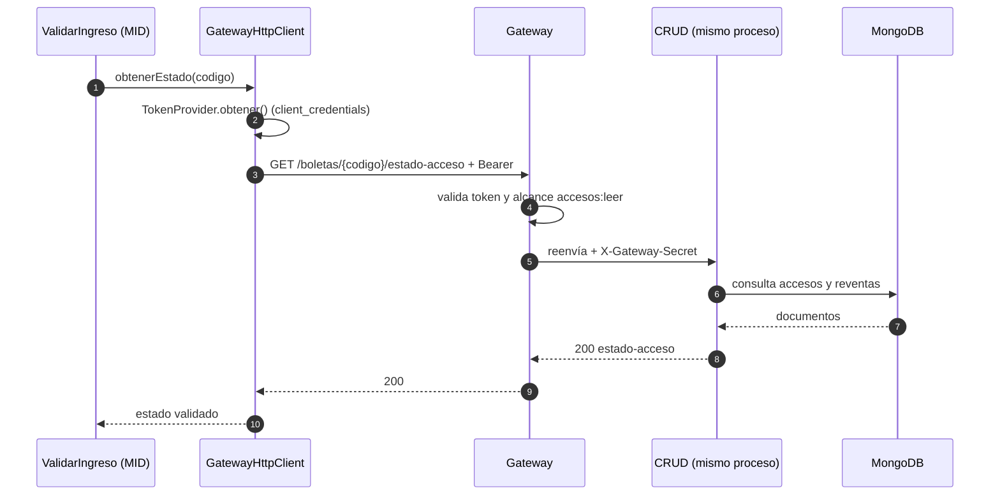

# Flujo de las peticiones entre módulos

Documento del microservicio **Acceso y reventa**. Describe cómo una petición recorre los adaptadores HTTP, los casos de uso, los puertos de salida y las dependencias externas. El servicio sigue arquitectura hexagonal: el dominio y los casos de uso no conocen Express ni Mongo.

## 1. Piezas que intervienen

| Pieza | Ubicación | Rol |
| --- | --- | --- |
| Gateway del clúster | Externo | Emite tokens, valida alcances, enruta y agrega `X-Gateway-Secret` |
| API CRUD propia | Mismo despliegue, `src/adapters/in/http/routes` | Accesos, reventas y estado de acceso (A-HU1, A-HU2, A-HU3) |
| API MID | Mismo despliegue | Valida ingreso y genera imagen QR (A-HU4 y tercero) |
| CRUD Eventos y boletas | Otro grupo, por gateway | Boleta y evento |
| QuickChart | Internet | Imagen PNG del QR |
| MongoDB | Base `pase-seguro` | Colecciones `accesos` y `reventas` |

**Importante:** el MID y el CRUD propio comparten proceso. El MID no importa repositorios: llama al CRUD **por HTTP a través del gateway**, igual que lo haría con cualquier otro servicio. Es un *loopback* que sale y vuelve al mismo despliegue; sus requisitos y riesgos están en [§11.1](#111-loopback-del-mid-hacia-su-propio-crud).

## 2. Arranque y composición

1. `src/main.ts` valida variables con Zod (`src/config/env.ts`).
2. `conectarMongo(env.MONGODB_URI)` abre el cliente; la base viene en la URI.
3. `crearIndices(db)` crea los índices de `accesos` y `reventas`.
4. `componer(db, cfg)` (`src/composition-root.ts`) construye:
   - `TokenProvider` y `GatewayHttpClient` (salida por gateway);
   - `BoletasGatewayHttp` (CRUD de Eventos);
   - `AccesosGatewayHttp` (CRUD propio);
   - `QuickChartQrClient` (tercero);
   - repositorios Mongo **solo** para los casos de uso del CRUD;
   - casos de uso y `crearServidor`.
5. `crearServidor` registra middlewares y rutas (`src/adapters/in/http/server.ts`).

## 3. Cadena de entrada

Orden real en `crearServidor`:

1. `express.json()` — cuerpo JSON.
2. `exigirGatewaySecret` — bloquea tráfico directo.
3. `healthRoutes` — `/health` y `/health/ready`.
4. `accesosRoutes` — `POST /accesos/validar`, `POST /accesos`, `GET /accesos`.
5. `reventasRoutes` — `GET /reventas`.
6. `estadoAccesoRoutes` — `GET /boletas/{codigo}/estado-acceso`.
7. `qrRoutes` — `GET /boletas/{codigo}/qr`.
8. `errorHandler` — traduce errores a HTTP.

`exigirGatewaySecret` deja públicas `/health`, `/health/ready`, `/openapi.json` y `/docs*`. Para el resto compara `X-Gateway-Secret` con `timingSafeEqual` y responde `403 no_gateway` si falta o difiere. Sin secreto configurado no bloquea (solo desarrollo local).

Cada ruta **solo declara el método, la ruta y el controlador**. La validación del cuerpo y la respuesta viven en `src/adapters/in/http/controllers`.

## 4. Diagrama general

## 5. Flujo MID: `POST /accesos/validar` (A-HU4)

`accesos.controller.ts` → `ValidarIngreso` → puertos de salida.

Reglas aplicadas en orden:

| Paso | Verificación | Error |
| --- | --- | --- |
| 1 | Formato `uuid.firma` y firma HMAC | `400 qr_invalido` |
| 2 | Boleta existe y está `vendida` | `404 boleta_inexistente`, `409 boleta_no_vendida` |
| 3 | Mismo evento, evento `activo` y fecha de hoy en `America/Bogota` | `409 boleta_otro_evento`, `409 evento_no_disponible`, `409 fuera_de_fecha` |
| 4 | Sin ingreso aceptado previo | `409 boleta_ya_usada` con puerta y hora del primero |
| 5 | Sin marca de reventa sospechosa | `403 boleta_bloqueada` |
| 6 | Registro del acceso aceptado | Si el CRUD responde `409 acceso_duplicado`, se traduce a `409 boleta_ya_usada` |

El identificador y la hora del acceso los asigna el **CRUD**, no el MID. En dos escaneos simultáneos, el índice único parcial del CRUD decide el ganador.

## 6. Flujo MID: `GET /boletas/{codigo}/qr` (API de tercero)

`qr.controller.ts` → `GenerarQrBoleta`.

1. Valida que `codigo` sea UUID y `tamano` esté entre 100 y 1000 px.
2. Consulta la boleta en Eventos y boletas; exige `vendida`.
3. Consulta `estado-acceso` en el CRUD propio; rechaza si ya ingresó o está bloqueada.
4. Firma `codigo` con HMAC-SHA256 (**Base64 estándar**) y arma `codigoQr = codigo.firma`.
5. Pide la imagen a QuickChart (`text`, `format=png`, `size`, `ecLevel=M`, `margin=2`, `User-Agent` propio).
6. Devuelve JSON con `codigoQr`, `imagenBase64`, `dataUrl`, `origenCache` y `degradado`; o binario `image/png` con `?formato=png`.

Comportamiento del cliente de tercero:

| Situación | Respuesta |
| --- | --- |
| Éxito | PNG validado por firma binaria, guardado en caché |
| Repetición dentro del TTL | `origenCache: true` sin llamar al proveedor |
| Peticiones concurrentes iguales | Una sola llamada (*single-flight*) |
| `429`, `5xx` o error de red | Reintentos limitados y luego degradación |
| Contenido que no es PNG | Degradación, sin guardar en caché |
| Degradado en modo JSON | `200`, `degradado: true`, `imagenBase64: null`, `codigoQr` válido |
| Degradado con `?formato=png` | `503 proveedor_qr_no_disponible` |

## 7. Flujos del CRUD propio

| Endpoint | Controlador y caso de uso | Acceso a datos |
| --- | --- | --- |
| `POST /accesos` | `registrarAccesoController` → `RegistrarAcceso` | Inserta en `accesos`; motivo obligatorio si es `rechazado` |
| `GET /accesos` | `listarAccesosController` → `ListarAccesos` | Filtra por `eventoId`, `boletaCodigo`, `resultado`; pagina |
| `GET /boletas/{codigo}/estado-acceso` | `obtenerEstadoAccesoController` → `ObtenerEstadoAcceso` | Cuenta aceptados, transferencias `completada` y marcas sospechosas |
| `GET /reventas` | `listarReventasController` → `ListarReventas` | Filtra por `vendedorId`, `boletaCodigo`, `marcaSospechosa` |

Sin historial, `estado-acceso` responde `200` con `ingreso: false`, `transferencias: 0`, `bloqueada: false`; nunca `404`.

## 8. Salida por el gateway

Toda llamada entre servicios pasa por `GatewayHttpClient`:

1. `TokenProvider.obtener()` entrega el JWT de `client_credentials`. Cachea, comparte una sola petición en vuelo (*single-flight*) y renueva 30 s antes de vencer.
2. Envía `Authorization: Bearer <token>`.
3. Conducta por respuesta:

| Respuesta | Conducta |
| --- | --- |
| `401` | Invalida el token, pide uno nuevo y reintenta **una sola vez** |
| `403` | No reintenta; `ServicioNoDisponible` (problema de alcances) |
| `404` | Se devuelve al caso de uso como «no existe» |
| `502/503/504` o red | Reintenta solo en `GET`, con espera creciente |
| `POST` sin confirmación | **No se repite**: el CRUD pudo haber escrito |

El `POST /accesos` del MID usa solo una tentativa para no duplicar intentos.

## 9. Modelo de errores

`errorHandler` traduce `DomainError` a HTTP:

| Código | HTTP |
| --- | --- |
| `qr_invalido`, `motivo_requerido` | 400 |
| `boleta_inexistente` | 404 |
| `boleta_no_vendida`, `boleta_otro_evento`, `evento_no_disponible`, `fuera_de_fecha`, `boleta_ya_usada`, `acceso_duplicado` | 409 |
| `boleta_bloqueada` | 403 |
| `servicio_no_disponible`, `proveedor_qr_no_disponible` | 503 |
| JSON mal formado | 400 `solicitud_invalida` |
| Cualquier otro | 500 `error_interno` sin filtrar el mensaje |

Formato común: `{ "codigo", "mensaje", "detalle" }`.

## 10. Persistencia

- Base `pase-seguro`; en pruebas, `pase-seguro-test` usa `accesos-test` y `reventas-test` (`src/adapters/out/mongo/colecciones.ts`).
- Índices (`indexes.ts`):
  - `accesos { boletaCodigo, resultado }`;
  - índice único parcial `uniq_acceso_aceptado_por_boleta` sobre `{ boletaCodigo }` cuando `resultado: "aceptado"` — garantiza un solo ingreso;
  - `reventas { boletaCodigo }` y `reventas { vendedorId, registradaEn }`.

## 11. Consideraciones de gateway

- El líder debe enrutar `/accesos`, `/reventas` y `/boletas/{codigo}/estado-acceso` al CRUD de Acceso y reventa, y `/boletas/{codigo}` y `/eventos/{id}` al CRUD de Eventos.
- La credencial del MID necesita `boletas:leer`, `accesos:leer` y `accesos:escribir`.
- El secreto `X-Gateway-Secret` lo agrega el gateway; el cliente nunca lo envía.
- El servicio rechaza con `403 no_gateway` cualquier llamada que intente saltarse el gateway.

### 11.1 Loopback del MID hacia su propio CRUD

El MID y el CRUD propio viven en el **mismo despliegue y el mismo proceso**, pero el MID **no** invoca los repositorios ni los casos de uso del CRUD en memoria. `ValidarIngreso` y `GenerarQrBoleta` dependen de los puertos HTTP `accesosGateway` y `boletasGateway` (`src/composition-root.ts:73-85`); los repositorios Mongo solo se inyectan en los casos de uso expuestos como CRUD (`:87-93`).

Por eso cada consulta o registro del MID es una llamada real que **sale del proceso, entra al gateway y vuelve al mismo servicio** por las rutas del CRUD. Es un *loopback* por el gateway, no una llamada entre módulos.

Consecuencias de diseño:

- **El gateway debe enrutar de vuelta al propio servicio** `/accesos` y `/boletas/{codigo}/estado-acceso`. Si no lo hace, el MID responde `503 servicio_no_disponible` aunque el CRUD y Mongo estén sanos.
- **Cada validación de ingreso cuesta varias llamadas**: `GET /boletas/{codigo}`, `GET /eventos/{id}`, `GET /boletas/{codigo}/estado-acceso` y `POST /accesos` (más `GET /accesos` y otro `POST` si se rechaza). La latencia y los límites del gateway importan.
- **La ruta `/boletas` es compartida**: `/boletas/{codigo}/estado-acceso` va al CRUD de Acceso y reventa, mientras `/boletas/{codigo}` va al CRUD de Eventos. El enrutamiento debe distinguirlas por sufijo, no solo por prefijo.
- **No hay atajo in-process**: si se quisiera evitar el loopback habría que inyectar los casos de uso del CRUD directamente en el MID, lo que rompería la demostración de consumo por gateway y el aislamiento entre APIs.
- **El token del MID debe tener los alcances propios**: sin `accesos:leer`/`accesos:escribir`, el gateway responde `403` y el MID lo convierte en `503` sin reintentar.

## 12. Trazabilidad

| Flujo | Prueba |
| --- | --- |
| Validación de ingreso y doble uso | `test/unit/application/validar-ingreso.test.ts` |
| Recorrido por ambos CRUD, gateway y QuickChart | `test/integration/arquitectura-comunicacion.test.ts` |
| Cliente del CRUD propio (409, 404, escritura sin reintento) | `test/unit/adapters/accesos.gateway.http.test.ts` |
| Estado de acceso | `test/unit/application/obtener-estado-acceso.test.ts` |
| Registro y filtros de accesos | `test/unit/application/registrar-acceso.test.ts` |
| Auditoría de reventas contra Mongo | `test/integration/reventa.repository.mongo.test.ts` |
| QuickChart, caché y degradación | `test/integration/quickchart-qr.client.test.ts` |
| Firma HMAC Base64 | `test/unit/adapters/qr-verifier.hmac.test.ts` |
